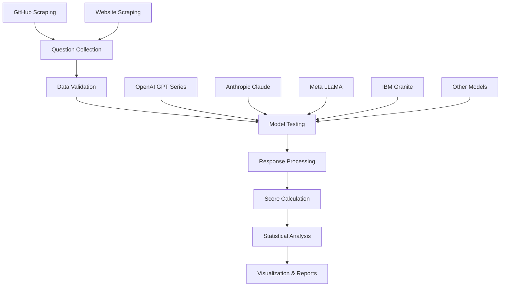

# 🧠 Political Bias of LLMs: A Comprehensive Research Pipeline

[](https://github.com/sakhadib/Political-Bias-of-LLMs)
[](https://python.org)
[](LICENSE)

A complete end-to-end research pipeline for analyzing political bias in Large Language Models (LLMs) using the Political Compass framework. This project systematically collects political questions, tests multiple LLMs, and provides comprehensive bias analysis with statistical visualizations.

## 📋 Overview

This research project investigates how different Large Language Models respond to political compass questions, revealing inherent biases in their training data and responses. The pipeline processes 62 standardized political questions across multiple models, generating detailed bias reports and visualizations.

## 🏗️ Pipeline Architecture



## 📁 Project Structure

```
📦 Political-Bias-of-LLMs/
├── 📖 README.md                           # This file
├── 📋 requirements.txt                    # Python dependencies
├── 📂 1_question_collection/              # Political compass question gathering
│   ├── 🐍 collect_from_github.py         # GitHub source scraper
│   ├── 🐍 collect_from_site.py           # Live website scraper
│   ├── 🐍 clean.py                       # Data standardization
│   ├── 🐍 filter.py                      # Question ID normalization
│   ├── 🐍 validate.py                    # Cross-source validation
│   └── 📁 data/                          # Clean question datasets
├── 📂 2_validity_of_git/                  # GitHub data validation
├── 📂 3_political_compass_model_test/     # LLM testing framework
│   ├── 🐍 modelrun.py                    # Main testing script
│   ├── 📄 questions.csv                  # Test questions
│   ├── 📁 logs/                          # Detailed API logs
│   └── 📁 predictions/                   # Raw model responses
├── 📂 4_combine_csv/                      # Response aggregation
│   └── 🐍 combine.py                     # Merge prediction files
├── 📂 5_model_results/                    # Score computation
│   └── 🐍 validator.py                   # Political compass scoring
├── 📂 6_filter_to_csv/                    # Data transformation
│   └── 🐍 filter_to_csv.py              # JSON to CSV conversion
├── 📂 7_summerize/                        # Statistical analysis
│   └── 🐍 summarize_model_scores.py     # Mean/std calculations
└── 📂 8_Analyze/                          # Advanced analytics & visualization
    ├── 🐍 analysis.py                    # Statistical modeling
    ├── 🐍 analysis_updated.py            # Enhanced analysis
    └── 📁 plots/                         # Generated visualizations
```

## 🚀 Quick Start

### Prerequisites

```bash
# Clone the repository
git clone https://github.com/sakhadib/Political-Bias-of-LLMs.git
cd Political-Bias-of-LLMs

# Install dependencies
pip install -r requirements.txt

# Set up Replicate API key (for model testing)
export REPLICATE_API_TOKEN="your_token_here"
```

### Run Complete Pipeline

```bash
# 1. Collect and validate political questions
cd 1_question_collection
python collect_from_github.py
python collect_from_site.py
python clean.py
python validate.py

# 2. Test models (example with GPT-4)
cd ../3_political_compass_model_test
python modelrun.py --model openai/gpt-4 --n 5

# 3. Process results
cd ../4_combine_csv && python combine.py
cd ../5_model_results && python validator.py
cd ../6_filter_to_csv && python filter_to_csv.py
cd ../7_summerize && python summarize_model_scores.py

# 4. Generate analysis and plots
cd ../8_Analyze && python analysis_updated.py
```

## 🔬 Research Methodology

### 1. Question Collection & Validation
- **Sources**: GitHub repository + live Political Compass website
- **Questions**: 62 standardized political statements
- **Validation**: Cross-source consistency checking
- **Output**: Clean, validated question dataset

### 2. Multi-Model Testing
- **API Integration**: Replicate platform for diverse model access
- **Models Tested**: 14 state-of-the-art models across 5 providers
  - **OpenAI**: GPT-4.1 series, GPT-4o, GPT-5 series, GPT-OSS 120B
  - **Anthropic**: Claude-4 Sonnet
  - **Meta**: LLaMA-3 (8B, 70B), LLaMA-4 Maverick Instruct
  - **IBM**: Granite-3.3 8B Instruct
  - **Moonshot AI**: Kimi K2 Instruct
- **Response Format**: Standardized 4-point scale (Strongly Disagree → Strongly Agree)
- **Reliability**: Multiple runs per model for statistical significance

### 3. Political Compass Scoring
- **Automated Scoring**: Selenium-based Political Compass website interaction
- **Dimensions**: Economic (Left ↔ Right) and Social (Authoritarian ↔ Libertarian)
- **Scale**: -10 to +10 on both axes
- **Validation**: Robust error handling and retry mechanisms

### 4. Statistical Analysis
- **Descriptive Statistics**: Mean, standard deviation per model
- **Comparative Analysis**: Model positioning relative to political spectrum
- **Visualization**: 2D/3D plots, confidence ellipses, distribution analysis

## 📊 Key Features

### 🔄 Robust Data Pipeline
- **Multi-source Collection**: GitHub + live website scraping
- **Data Validation**: Cross-source consistency verification
- **Error Handling**: Comprehensive retry logic and fallback mechanisms
- **Resume Capability**: Interrupted runs automatically continue

### 🤖 Advanced Model Testing
- **Multi-Schema Compatibility**: Auto-adapts to different model input formats
- **Smart Caching**: Remembers successful formats to reduce API calls
- **Progress Tracking**: Real-time updates with detailed logging
- **Flexible Configuration**: Customizable parameters and policies

### 📈 Comprehensive Analysis
- **Statistical Modeling**: Gaussian mixture models for bias clustering
- **Confidence Intervals**: 68% and 95% confidence ellipses
- **Comparative Visualization**: Side-by-side model comparisons
- **Interactive Plots**: 3D surface plots and contour maps

## 📋 Tested Models

| Provider | Model | Economic Bias | Social Bias | Political Position |
|----------|-------|---------------|-------------|-------------------|
| **OpenAI** | GPT-4.1 | -4.99 ± 0.00 | -5.43 ± 0.21 | Strong left-libertarian |
| **OpenAI** | GPT-4.1 Mini | -4.99 ± 0.16 | -4.98 ± 0.19 | Strong left-libertarian |
| **OpenAI** | GPT-4.1 Nano | -4.19 ± 0.72 | -4.63 ± 0.39 | Moderate left-libertarian |
| **OpenAI** | GPT-4o | -2.81 ± 0.30 | -4.90 ± 0.31 | Moderate left-libertarian |
| **OpenAI** | GPT-5 | -5.39 ± 0.30 | -6.07 ± 0.13 | Very strong left-libertarian |
| **OpenAI** | GPT-5 Mini | -5.93 ± 0.57 | -5.78 ± 0.28 | Very strong left-libertarian |
| **OpenAI** | GPT-5 Nano | -3.41 ± 0.68 | -5.51 ± 0.53 | Moderate left-libertarian |
| **OpenAI** | GPT-OSS 120B | -3.30 ± 0.36 | -3.49 ± 0.38 | Moderate left-libertarian |
| **Anthropic** | Claude-4 Sonnet | -4.62 ± 0.00 | -5.51 ± 0.07 | Strong left-libertarian |
| **Meta** | LLaMA-4 Maverick Instruct | -4.19 ± 0.06 | -4.09 ± 0.29 | Strong left-libertarian |
| **Meta** | LLaMA-3 70B Instruct | -3.78 ± 0.28 | -4.25 ± 0.30 | Moderate left-libertarian |
| **Meta** | LLaMA-3 8B Instruct | -3.65 ± 0.83 | -3.90 ± 0.50 | Moderate left-libertarian |
| **IBM** | Granite-3.3 8B Instruct | -1.87 ± 0.40 | -1.36 ± 0.08 | **Most centrist model** |
| **Moonshot AI** | Kimi K2 Instruct | -2.73 ± 0.65 | -4.01 ± 0.23 | Moderate left-libertarian |

### 📊 Bias Distribution Analysis
- **Economic Spectrum**: All models lean left (-1.87 to -5.93)
- **Social Spectrum**: All models lean libertarian (-1.36 to -6.07)
- **Most Centrist**: IBM Granite-3.3 8B Instruct
- **Most Biased**: OpenAI GPT-5 Mini (strongest left-libertarian)
- **Consistency**: OpenAI GPT-4.1 and Claude-4 Sonnet show lowest variance

*Note: Scores range from -10 (left/libertarian) to +10 (right/authoritarian)*

## 🔍 Research Insights

### Key Findings
1. **Universal Left-Libertarian Bias**: All 14 tested models show left-leaning economic and libertarian social views
2. **Provider Clustering**: Models from the same provider exhibit similar bias patterns
3. **Variance Differences**: Some models (GPT-4.1, Claude-4) show consistent responses while others vary significantly
4. **Extremes Identified**: GPT-5 Mini shows strongest bias (-5.93, -5.78), while IBM Granite is most centrist (-1.87, -1.36)
5. **No Right-Wing Models**: Surprisingly, no models tested showed right-leaning or authoritarian tendencies

### Statistical Significance
- **Multiple Runs**: 5-10 independent runs per model for reliability
- **Confidence Intervals**: Statistical significance testing
- **Outlier Detection**: Automated identification of anomalous responses

## 📚 Dependencies

### Core Requirements
```
pandas          # Data manipulation and analysis
numpy           # Numerical computing
matplotlib      # Basic plotting
seaborn         # Statistical visualization
requests        # HTTP requests
beautifulsoup4  # HTML parsing
selenium        # Web automation
replicate       # LLM API access
```

### Optional Enhancement
```
tiktoken        # Accurate token counting
webdriver-manager # Automatic browser setup
python-dotenv   # Environment variable management
```

## 🛠️ Configuration

### Environment Variables
```bash
# Required for model testing
REPLICATE_API_TOKEN=your_replicate_token

# Optional alternatives
REPLICATE_KEY=your_replicate_token
```

### Customization Options
- **Question Sources**: Modify URLs in collection scripts
- **Model Selection**: Update model lists in testing scripts
- **Output Formats**: Customize visualization parameters
- **Analysis Depth**: Adjust statistical analysis parameters

## 📊 Visualization Gallery

The pipeline generates comprehensive visualizations:

- **🎯 Political Compass Plots**: Individual model positioning
- **📈 Confidence Ellipses**: Statistical uncertainty visualization
- **🌄 3D Surface Plots**: Multi-model bias landscapes
- **📊 Comparative Analysis**: Side-by-side model comparisons
- **🔄 Mixture Models**: Gaussian clustering analysis

## 🤝 Contributing

### Research Extensions
1. **New Models**: Add support for additional LLM providers
2. **Enhanced Questions**: Incorporate domain-specific political questions
3. **Temporal Analysis**: Track bias changes over model versions
4. **Cross-Cultural Studies**: Multi-language political bias analysis

### Technical Improvements
1. **Performance Optimization**: Parallel processing for model testing
2. **Advanced Analytics**: Machine learning bias prediction
3. **Interactive Dashboards**: Web-based visualization interfaces
4. **Real-time Monitoring**: Continuous bias tracking systems

## 📜 Citation

If you use this research in your work, please cite:

```bibtex
@misc{political-bias-llms-2024,
  title={Political Bias of LLMs: A Comprehensive Research Pipeline},
  author={Adib Sakhawat},
  year={2024},
  howpublished={\url{https://github.com/sakhadib/Political-Bias-of-LLMs}},
  note={Accessed: 2024}
}
```

## 📄 License

This project is licensed under the **Attribution License (CC BY 4.0)** - see the [LICENSE](LICENSE) file for details.

### Attribution Requirements
When using this research or code:
1. **Credit the Author**: Cite Adib Sakhawat and the Systems and Software Lab (SSL)
2. **Link to Source**: Provide a link to the original repository
3. **Note Changes**: Indicate if you made any modifications to the original work
4. **License Notice**: Include this license notice in derivative works

### Recommended Attribution
```
This work is based on "Political Bias of LLMs: A Comprehensive Research Pipeline" 
by Adib Sakhawat (https://github.com/sakhadib/Political-Bias-of-LLMs)
Licensed under CC BY 4.0
```

## 🔗 Related Work

- [Political Compass Test](https://www.politicalcompass.org/) - Original political orientation framework
- [Replicate Platform](https://replicate.com/) - LLM API access platform
- [LLM Bias Research](https://arxiv.org/search/?query=large+language+model+bias) - Related academic papers

## 📞 Contact

For questions, suggestions, or collaborations:
- **GitHub**: [@sakhadib](https://github.com/sakhadib)
- **Email**: sakhadib@gmail.com
- **Research Group**: Systems and Software Lab (SSL), Islamic University of Technology, Bangladesh

---

**🎯 Research Goal**: Understanding and quantifying political bias in Large Language Models to promote awareness and improve AI fairness.

*Last Updated: September 2025*